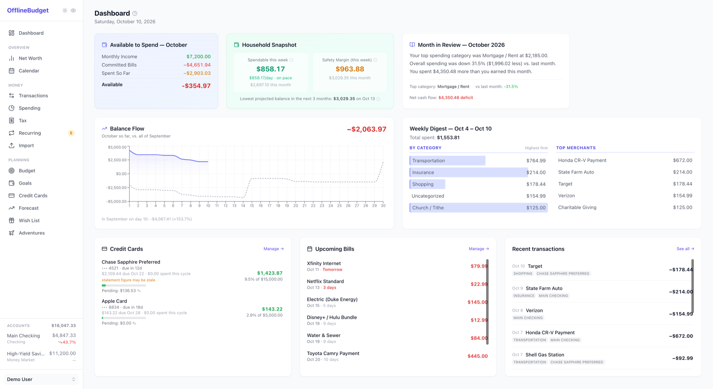
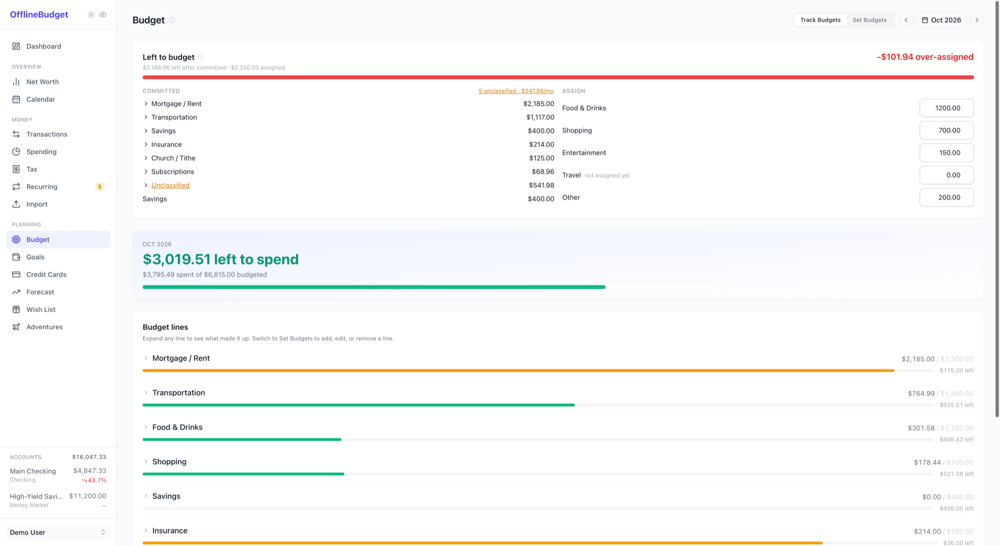
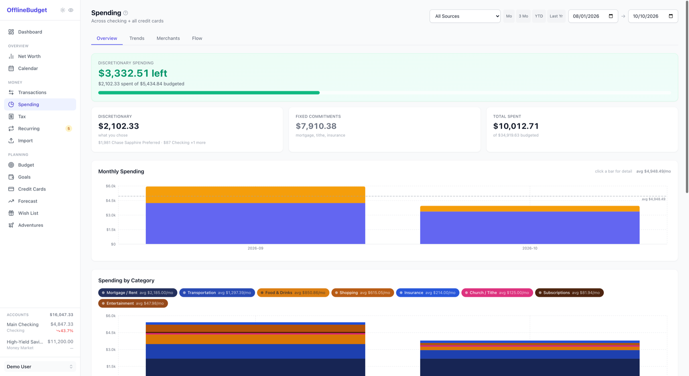
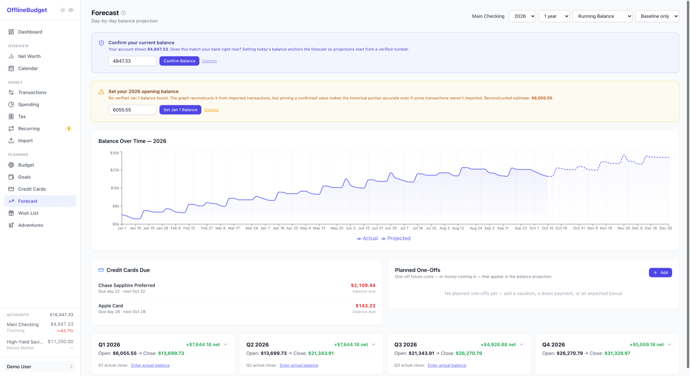
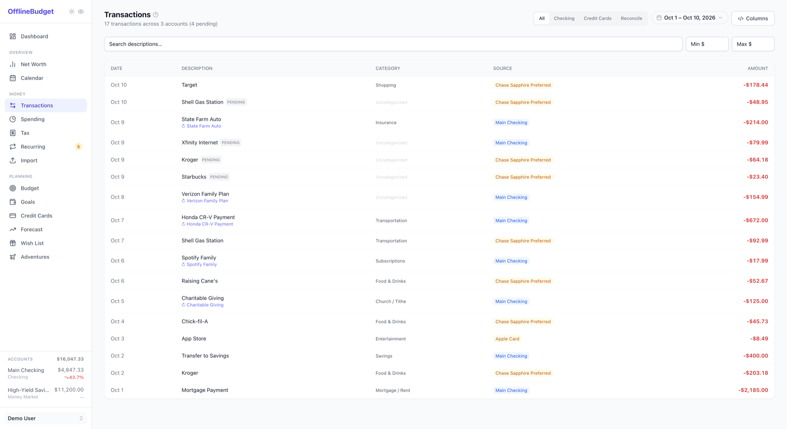
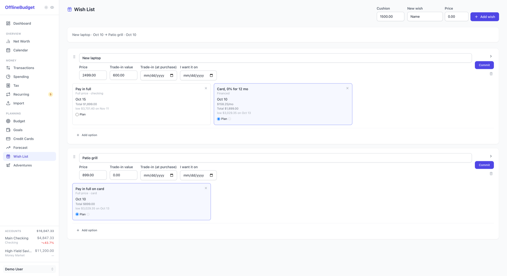

# OfflineBudget

A forecasting-first household budget tracker you host yourself. Your ledger
lives on your machine in a single SQLite file — bank sync and email are
opt-in and off by default, so you can run the whole thing with nothing
leaving your network.

See [what leaves your machine](PRIVACY.md) for the specifics.

Built with FastAPI + SQLite on the backend and React + TypeScript on the
frontend.

---

## Guides

| Guide | What's in it |
|-------|--------------|
| [Getting Started](start-guide.md) | Install, first run, LAN access, setting up your first budget |
| [Technical Guide](technical-guide.md) | Architecture, data model, the forecast engine, adding features |
| [Privacy](PRIVACY.md) | What's stored, the three outbound calls, and how to delete everything |
| [Demo Data](demo-data.md) | The bundled sample household and how to load it |
| [Future Work](future-work.md) | What's planned next |

Source and issues: [github.com/rookford343/OfflineBudget](https://github.com/rookford343/OfflineBudget)

---

## What it looks like

Every screenshot below uses the bundled demo dataset — a fictional
dual-income household. No real financial data appears in this repository.

### Dashboard

Household Snapshot, Available to Spend, and a plain-English month in review.

### Budget

One headline answering "how much is left this month", then a progress bar per
category. The checking-vs-card split is one click away rather than a column.

### Spending

Leads with discretionary spend — the part you actually decide — with fixed
commitments reported separately.

### Forecast

Day-by-day balance projection, credit cards due, and planned one-offs.

### Transactions

Checking and every card in one view. Charges your card issuer still lists as
pending carry a **pending** badge and drop off once they post.

### Wish List

Ranked purchases with payment options, and the earliest date your forecast
can take each one.

### Adventures

Trips priced in cash and points, with transfer suggestions from your points
wallet.

---

## The ideas behind it

**Forecast first.** Most budget apps tell you what you already spent. The
question that actually changes a decision is what your balance will be on the
25th, so the forecast engine walks every day forward from today: recurring
bills, paychecks, credit-card payoffs on their real statement cycle, and any
one-off you've planned.

**Discretionary is the number that matters.** A spending list topped by your
mortgage tells you nothing you can act on. Fixed commitments are separated
from the spending you actually chose.

**Money moving between your own accounts isn't spending.** Transfers and
credit-card payoffs are excluded from spending totals — a payoff settles
charges already counted individually, so counting it again would
double-count the whole statement.

**It should survive a laptop that sleeps.** Scheduled email and bank sync
both self-heal: a missed trigger fires when the machine wakes, and a periodic
sweep retries anything that hasn't succeeded today.

---

## Bank sync: Plaid and SimpleFIN

Connecting a bank is optional either way — see [Getting Started](start-guide.md)
for signing up with each provider. Once you're connected, here's how the two
behave day to day.

**Connecting and mapping accounts.** Click **Connect with Plaid** in
**Settings → Accounts & Bank Sync** and log in to your bank through the
window Plaid opens. The app then lists the accounts it found — checking,
savings, cards — and you map each one to an account or card already in the
app. If an account is already synced by another connection, mapping it
names that connection ("Already synced by SimpleFIN. Switch to this one?")
and offers **Switch** instead of a conflict: one click moves that
account over, deactivating the old SimpleFIN link rather than deleting it,
so switching back later is just as easy.

**Previewing and confirming the first import.** The first time Plaid syncs
a newly-linked account, the app shows you a preview before anything is
written. Every row is labeled:

- **Imported** — a new transaction, about to be added.
- **Matched** — the same real-world transaction the app already has (from
  SimpleFIN, a CSV import, or an earlier sync); it's kept exactly as it is,
  not duplicated.
- **Ignored** — too old to matter; see the cutover window below.

Review the preview, then click confirm to apply it for real. Nothing is
written until you do.

If the preview lists accounts that aren't mapped, map them first (**Map
more accounts**) unless you really don't want them: once you confirm, their
transactions are skipped for good. To confirm anyway, tick the checkbox
under that warning.

Right after you link a bank, Plaid may still be fetching your history. The
preview then says "Plaid is still fetching your history; try again in a
minute" and nothing is saved; wait a minute and click **Preview first
import** again. The button goes away once the first import is done.

**The cutover window.** When you switch an account to Plaid, Plaid resends
some history the old provider already had, under its own transaction ids —
so the app can't just rely on "have I seen this id before." For transactions
dated from **10 days before** the switch through **3 days after** it, the
app instead matches by amount, date and description against what's already
there. A match is left alone; only transactions with no match get imported.
Anything older than that 10-day window is ignored outright, on the
assumption your other provider or a CSV import already has it.

**Reconnecting.** Banks occasionally require you to log in again. When
that happens, the connection in **Settings → Accounts & Bank Sync** shows
"Your bank needs you to log in again. Use Reconnect in Settings → Accounts."
and a **Reconnect** button. Click it and log in again in the window that
opens; the app runs a sync straight away, and the error clears once it
succeeds.

**The schedule.** Plaid syncs four times a day — 7am, 11am, 3pm and 7pm.
SimpleFIN syncs once, at 7am (the old 3:17pm credit-card-only refresh is
gone — Plaid's more frequent syncing replaced the need for it). **Sync Now**
in Settings runs everything, on demand, anytime.

**Statement balances.** For cards linked through Plaid, the due date and
minimum payment fill in automatically as soon as Plaid sees a statement —
including the very first one. The balance stays live from sync to sync: on
every Plaid sync the app recomputes what's still owed on the current
statement from the issuer's own data — the statement total minus any
payment or return posted since it closed. A card the issuer shows paid in
full (autopay, a refund, any combination of the two) clears to $0 right
away, instead of waiting for the next statement. The recompute only ever
lowers the figure, never raises it, so a balance you've already typed in
or paid down by hand is safe until the real payoff posts.
